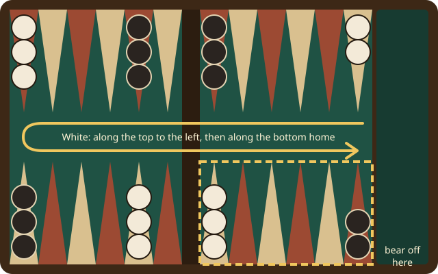

# Backgammon

Be the first to bring all fifteen of your checkers home and bear them off the board.

## In short

- Roll two dice; each die moves one checker that many points. Doubles count four times.
- On the board: tap the dice to roll, tap a checker, then where it goes, then **Done**.
- A lone checker that is hit goes to the bar and must come in again first.
- With all your checkers home, bear them off. First to bear off all fifteen wins.

## The board

Each side has 24 points, numbered from its own home: White counts 24 down to 1, Black the same from the other end, so both move toward their own home board at their right hand. White's home is points 1 to 6, in front of White on the right. The **bar** divides the board in the middle; the **tray** at the side takes the checkers borne off.

The game starts with two checkers on your 24-point, five on your 13, three on your 8 and five on your 6.

## A turn

1. **Roll.** Each game starts with the opening roll, thrown for you: one die each (a tie is thrown again), and the player with the higher die plays both numbers. After that, tap the dice on the board or **Roll** on your phone.
2. **Move.** Each die moves one checker that many points, to a point that is empty, holds your own checkers, or holds a single opposing checker. Two or more opposing checkers block a point. Doubles move four times.
3. **Done.** Tap **Done** on the board or the phone. Until then, **Undo** takes back your moves one at a time, all of them if you like. With Undo turned off for the match, the turn ends by itself as soon as your dice are played. A target that hits a lone opposing checker lights up red.

You must use both dice if you can, and if only one can be played, the larger one. If no move is possible, the turn passes by itself. The board lights up only the moves that are allowed; a checker can also go several dice at once (tap the far point). The phone lists the single moves too, as buttons, in your own numbering.

## Options

On your phone, under *Options*, at any time during the match:

- **Roll for me** (your own): *On* rolls your dice as your turn begins. When you could double, it waits a moment first, so you can still double.
- **Undo** (for both players): *All moves* (the start) takes back every move of the turn until Done. *Off* takes Undo away, and every turn ends by itself once its dice are played. The board's settings have it too.

The settings before the match, **Undo** (*all* or *none*) and **Roll for me**, choose the start.

## Hitting and the bar

Landing on a single opposing checker **hits** it: it goes to the bar. A player with a checker on the bar must bring it in first, into the opponent's home board (a 3 comes in on the opponent's third point, your 22), before moving anything else.

## Bearing off

When all fifteen of your checkers are in your home board you may bear them off: a die takes a checker off from the point of that number. A die higher than your highest checker bears that checker off. You may also move inside your home instead.

## Winning and points

- Bearing off all your checkers wins the game: **1 point**.
- A **gammon** (2 points): the other side has not borne off any checker.
- A **backgammon** (3 points): the other side has borne off none and still has a checker on the bar or in your home board.

**Points to win the match** sets how many points win the match (1 plays a single game). The board shows the score and starts the next game by itself; **Next game** skips the wait.

Each player's panel on the board shows their points so far and their **pips**: how far all their checkers still have to travel to bear off (a checker on your 13-point counts 13, one on the bar 25). Both players start with 167; fewer pips means you are ahead in the race.

## The doubling cube

With the **Doubling cube** on, before rolling you may double (on your phone, or **Double** on the board, tapped twice to be sure): the other player either **takes**, plays on for twice the points and gets the cube, or **passes** and loses this game at the cube's value before the double. **Take** and **Pass** are on the phone and on the board, under the double in that player's box, so the whole match can be played on the board. Only the player holding the cube may double again; a cube in the middle belongs to both. In the **Crawford game**, the first game after a player gets within one point of winning the match, nobody may double. A double that could not change the match any more is not offered.

## Time and changing players

**Seconds per turn (0 = no limit)** gives each turn a time limit; when it runs out, the table plays the turn for the player (and takes a double for them; it never doubles for them). An AI player's **Strength** is beginner, average or strong, set in its settings on the board.

A match keeps its two players. If someone has to go, the board can exchange them for another person or an AI player (tap their name in the board's settings, or **Exchange** at their seat when their phone is away): the newcomer plays on with the same colour, score and cube.

> Tip: tap a picked-up checker again to put it down, or tap another one of yours instead.
