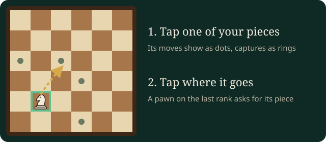

# Chess

Checkmate the other king: attack it so that it cannot escape.

## In short

- White moves first, then you take turns. Make your move **on the board**: tap one of your pieces, then the square it goes to.
- Your phone shows both clocks and every move, and lets you offer a draw or resign.
- With a clock, your time runs only while it is your turn; run out and you lose.
- Checkmate wins. Stalemate, a position seen three times, or too little material to mate is a draw.

## The pieces

| Piece | Moves |
| --- | --- |
| King | One square any way |
| Queen | Any distance, straight or diagonal |
| Rook | Any distance, straight |
| Bishop | Any distance, diagonal |
| Knight | An L: two one way, one to the side; jumps |
| Pawn | One forward (two from its start); takes one diagonally forward |

A piece takes an opponent's piece by moving onto its square. Only the knight jumps over others.

## Special moves

- **Castling:** the king moves two squares toward a rook and the rook jumps over it. Neither may have moved, the squares between must be empty, and the king may not be in check, pass through check or land in check. Tap the king, then the square two to its side.
- **En passant:** a pawn that moves two squares past an opponent's pawn beside it can be taken as if it had moved one, but only right away.
- **Promotion:** a pawn reaching the far rank becomes a queen, rook, bishop or knight; the board asks which.

## Check and the end

A king under attack is in **check**: you must get it out of check. No way out is **checkmate**, and the game is lost. The game is also over when:

- a player **resigns** (on the phone, tap Resign twice),
- both agree to a **draw** (offer it on your phone; making a move declines an offer),
- the side to move has no legal move but is not in check (**stalemate**: a draw),
- the same position comes up for the third time, or fifty moves go by without a capture or pawn move (a draw),
- neither side has enough pieces to mate (a draw),
- a clock runs out: that player loses, unless the other has too little to ever mate (then a draw).

## Clocks

**Time control (minutes + seconds per move)** sets the clocks: "10+5" gives each player ten minutes, and five seconds come back after each of your moves. "no clock" plays without. The settings offer bullet (1+0), blitz (3+2, 5+3), rapid (10+0, 10+5) and classical (15+10, 30+0). A pause on the table stops both clocks.

## Seats and colours

**White plays from** decides who gets white: the south seat, the north seat, or chance. The board is turned so that White's first rank is in front of White, and each side's pieces stand up for their own player.

## AI players and players who leave

An AI player's strength is set as an approximate Elo rating (400 for a beginner, 2200 for a strong club player) in its settings on the board.

If a player leaves during the game, the **stand-in** plays on for them in their colour, at the **Stand-in strength (Elo) for a player who leaves**. Someone who sits down in the empty seat takes over from it. A phone that drops out gets a minute to come back before the stand-in takes over; their clock keeps running meanwhile.

> Tip: tap a picked-up piece again to put it back, or tap another of your pieces instead.
