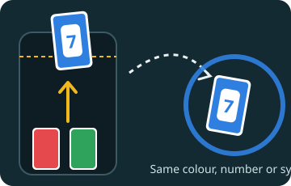

# Last Card

Be the first to play all your cards, again and again, until you reach the points to win. For 2 to 8 players.

## In short

- On your turn, push a card up and off the top of your phone onto the pile: same colour, or same number or symbol.
- Skip, Reverse and Draw Two hit the next player; a Wild picks the colour.
- Nothing fits? Draw a card. Play it if it fits, or keep it.
- Play your last card first to score what everyone else still holds.

## Playing a card

The cards that fit the pile lift and glow on your phone when it is your turn. Touch one and push it up: it leaves your phone at the top and comes onto the board at your edge. Let go with more than half of it out, or flick it, and it flies onto the pile. A card that doesn't fit bounces back.

A card fits when it has the colour shown around the pile, or the same number or symbol as the top card. Wild cards always fit; you pick the colour the next player must play.

## The special cards

| Card | What it does |
|---|---|
| Skip | The next player misses their turn. |
| Reverse | Play goes the other way round. With two players it works like Skip. |
| Draw Two | The next player draws two cards and misses their turn. |
| Wild | You pick the colour. |
| Wild Draw Four | You pick the colour, and the next player draws four cards and misses their turn. |

## Drawing

If nothing fits, tap **Draw a card**. If the new card fits you may play it straight away, or tap **Keep it**. If it doesn't fit, your turn ends. When the draw pile runs out, the pile is shuffled into a new one, all but its top card.

When you are down to one card, the board calls **Last card!** for you.

## Scoring

The first player to play all their cards wins the round and scores the cards left in everyone else's hands: numbers count their value, Skip, Reverse and Draw Two 20, wild cards 50. The first to the **Points to win the game** wins.

## Settings

| Setting | Default | What it does |
|---|---|---|
| Points to win the game | 200 | The game ends when a player reaches it. |
| Seconds per turn (0 = no limit) | 30 | When time runs out, the table plays a card for you, or draws. |
| Seconds to show the scores after a round | 12 | The pause before the next round is dealt. |
| Tap a card to play it (as well as pushing it off) | Off | A short tap on a card that fits plays it, too. |

On the board, **Card animation** in the settings makes cards fly faster or slower.
