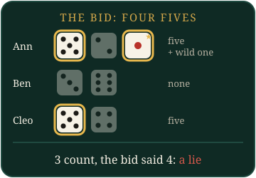

# Liar's Dice

Be the last player with dice. Everyone rolls in secret; you bid on what is under *all* the cups together, or call the last bid a lie.

## What you see

- **Your phone** shows your own dice and nobody else's. On your turn it has the bid builder and the **Liar!** button.
- **The board** shows the current bid, whose turn it is, how many dice each player has left, and, after a call, every cup laid open.

## How a round works

1. Everyone rolls their dice. Only you see yours.
2. The opening player bids: a number of dice and a face, like "three fives". It means *there are at least three fives on the whole table*, counting everyone's dice.
3. Turns pass around the table. On your turn you either **raise** or call **Liar!**
4. A raise is more dice of any face ("four twos" beats "three fives"), or the same number of a higher face ("three sixes" beats "three fives").
5. Calling **Liar!** ends the round: every cup is opened on the board and the dice that match the bid are counted.

## Who loses a die

- If there are **at least** as many as bid, the bid holds and the **caller** loses a die.
- If there are fewer, the bid was a lie and the **bidder** loses a die.
- An exact count holds.

The loser opens the next round. Lose your last die and you are out; you can still watch the reveals on the board.

## Wild ones

With **Ones are wild** on (the default), every one counts as whatever face is being bid. Because of that, you can't bid on ones. Turn it off and ones are a normal face that you can bid on.

## When time runs out

If **Seconds per turn** runs out:

- With no bid yet, the table opens for you with one die of the face you hold most.
- With a bid in front of you, the table calls **Liar!** for you.

## Settings

| Setting | Default | What it does |
|---|---|---|
| Dice per player | 5 | Dice each player starts with (2 to 6) |
| Ones are wild | On | Ones count toward every bid on another face |
| Seconds per turn (0 = no limit) | 45 | Time to bid or call |
| Seconds to show the dice after a call | 6 | How long the open cups stay up |

## Leaving and the end

If a player leaves in the middle of a round, the round starts again with fresh dice for everyone else, since the bids so far counted their dice. The last player with dice wins.

## Tips

- Count what you can see: your own dice plus about a third of the others' for any face (with wild ones), a sixth without.
- The bigger the table, the bolder a bid can be.
> AI players come in two styles: *cautious* players call early, *bold* ones believe more and sometimes push the bid a die further.
