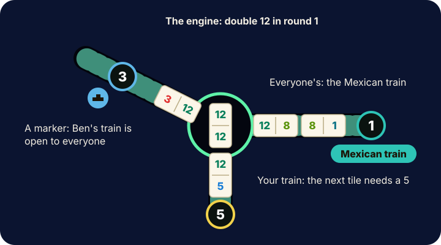

# Mexican Train

Get rid of your tiles: after the last round, the player with the fewest points wins.

## In short

- Each round starts from a double in the middle, the **engine**: double twelve, then one lower each round.
- Build **your own train** toward your seat; each tile must match the number at its open end.
- The **Mexican train**, and any train with a **marker**, are open to everyone.
- Can't play? **Draw**. Still nothing? You pass, and a marker goes on your train.
- Play your last tile to end the round; everyone scores the pips left in their hand.

## Your phone

Your tiles are on your phone only; nobody else sees them. On your turn the tiles that fit **glow**. Tap one, then
tap a highlighted train to play it there. If a tile fits only one train, tapping it a second time plays it there.
The big number on each train is the number its next tile must match.

## A turn

On your turn you play **one tile** on:

- your own train,
- the Mexican train, or
- any train with a marker.

Playing on your own train takes your marker off it.

If no tile fits, tap **Draw a tile**. A tile that fits after drawing must be played; if it doesn't fit either, you
pass and a marker goes on your train, so anyone may play on it until you play there again.

## Doubles

A double is laid across its train, and you **play again** right away. Before anyone plays anywhere else, the double
must be **covered**: the next tile goes on it. If you can't cover it, draw; if that doesn't help, you pass with a
marker on your train, and the next player must try to cover it.

## First turn of a round

With the setting **First turn of a round: play a run of tiles on your own train** (on unless the table changes it),
your first turn of every round may be a whole run: as long as you keep playing on your own train, it stays your turn.
Tap **Done** to end the run, or play on another train to end it there.

## End of a round

A round ends when someone plays their last tile, or when nothing is left to draw and nobody can play. Everyone counts
the pips left in their hand; that is their score for the round. With **Double blank counts 50 points**, a double blank
left in a hand counts 50.

The next round starts from the next lower double. **Rounds** sets how many there are: 13 goes all the way from double
twelve down to double blank.

## Time

**Seconds per turn (0 = no limit)** gives each turn a limit. When your time runs out, the table plays a tile that fits
for you, or draws one. **Seconds to show the scores after a round** sets how long the scores stay on the board before
the next round is dealt; the board's **Next round** button deals it at once.

## The table

The **board settings** (the gear) choose the background, a new background each round, the music, how the tiles look
and whether the train ends show big numbers. They change only the look, never the game.
